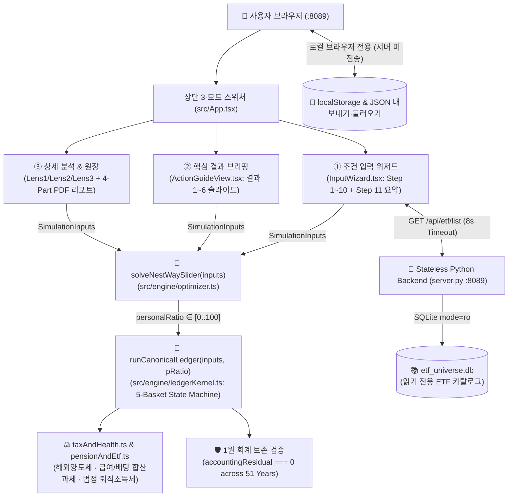

# 🧒 NestWay Slider (:8089) — ELI5 완벽 해부 가이드 (아키텍처 · 금융 엔진 · 사용 매뉴얼)

> **"Big Pictures, Few Words"** — 5살 어린이와 비전공자도 단번에 이해할 수 있는 **일상 속 비유(👶 Everyday Metaphor)**와 엔지니어링 정본 코드(**⚙️ Under The Hood**)를 1:1로 매칭한 공식 가이드입니다.  
> **시각화 인터랙티브 버전**: [`eli5_guide.html`](./eli5_guide.html)

---

## 🏗️ 1. 상세 아키텍처 (Architecture ELI5)

### 🎯 한 줄 핵심 요약 (1-Sentence Essence)
- **👶 일상 비유**: **"친절한 9장의 질문 카드(위자드)로 여행 준비물을 챙기고, 황금 다이얼 슬라이더 하나로 100세까지의 물줄기를 실시간 조절하는 스마트 은퇴 내비게이션"**이에요!
- **⚙️ 실제 동작**: 브라우저에서 **100% 결정론적 순수 TypeScript 원장 커널(`src/engine/**`)**이 ~40ms 안에 51개년 현금흐름과 최적 개인·법인 배분 비율(`r*`)을 계산하고, 파이썬 표준 라이브러리 무상태 백엔드(`server.py`, `:8089`)가 정적 웹앱과 선택적 **ETF SQLite 카탈로그(`etf_universe.db`)**를 읽기 전용(`mode=ro`)으로 제공하는 독립 웹 애플리케이션입니다.

---

### 🥪 일상 비유 vs ⚙️ 실제 내부 구조 1:1 매칭표

| 구성 요소 | 👶 일상 속 비유 (Everyday Metaphor) | ⚙️ 실제 코드 & 파일 경로 (Under The Hood) |
| :--- | :--- | :--- |
| **내 컴퓨터 전용 보관함** | 내 계획표를 서버에 보내지 않고 내 브라우저 서랍에 보관하고, 파일로 내려받아 백업하는 개인 금고 | `localStorage` + [`scenarioIo.ts`](./src/lib/scenarioIo.ts) (`📥 내보내기` / `📤 불러오기` 1MB 정화 검증) |
| **탭 1: 10+1 질문 카드** | 한 번에 질문 하나씩만 물어봐서 머리 아프지 않게 여행 가방을 싸 주는 친절한 가이드 | [`InputWizard.tsx`](./src/components/InputWizard.tsx) (`① 조건 입력 (단계별 위저드)` — Step 1~10 집중 입력 카드 + Step 11 전체 요약 검증 화면) |
| **탭 2: 6장 핵심 결과 브리핑** | 가장 중요한 결론부터 한 장씩 차근차근 짚어주는 6장의 요약 슬라이드 | [`ActionGuideView.tsx`](./src/components/ActionGuideView.tsx) (`② 핵심 결과 브리핑 (단계별 슬라이드)` — 결과 1~6 집중 브리핑) |
| **탭 3: 4칸 심층 분석 & 51개년 원장** | 배분 곡선, 5대 계좌 흐름, 출구전략, 51개년 1원 원장표를 펼쳐보는 분석실 | [`Lens1AllocationTrack.tsx`](./src/components/Lens1AllocationTrack.tsx) · [`Lens2WaterfallLedger.tsx`](./src/components/Lens2WaterfallLedger.tsx) · [`Lens3StrategyMatrix.tsx`](./src/components/Lens3StrategyMatrix.tsx) (`③ 상세 분석 & 원장`) |
| **ETF 도서관** | 한국과 미국의 대표 ETF 중 원하는 종목을 골라 바구니에 담는 코너 | [`server.py`](./server.py) (`GET /api/etf/list`) + [`EtfPortfolioBuilder.tsx`](./src/components/EtfPortfolioBuilder.tsx) |
| **두뇌 계산기 (정본 원장 엔진)** | 5개의 투명 유리병에 담긴 물방울을 50세부터 100세까지 단 한 방울도 흘리지 않고 계산하는 슈퍼컴퓨터 | [`src/engine/ledgerKernel.ts`](./src/engine/ledgerKernel.ts) (`runCanonicalLedger`) + [`src/engine/optimizer.ts`](./src/engine/optimizer.ts) (`solveNestWaySlider`) |

---

### 🖼️ 시스템 데이터 흐름도 (Architecture & Data Flow)

---

## 🏺 2. 금융 엔진 (Financial Engine ELI5)

### 🎯 한 줄 핵심 요약 (1-Sentence Essence)
- **👶 일상 비유**: **"이름표가 붙은 5개의 투명 유리병(`IRP` · `ISA` · `연금저축` · `일반계좌` · `가족법인`)에 돈을 나눠 담고, 세금 도깨비에게 가장 적게 뺏기는 순서(8단계 수도꼭지)로 물을 따라 쓰면서 100세까지 단 1원도 잃어버리지 않는 마법 원장"**이에요!
- **⚙️ 실제 동작**: 개인 100%(`p=100`), 법인 100%(`p=0`), 하이브리드(`0 < p < 100`) 전략을 별도 코드 분기 없이 오직 **`runCanonicalLedger(inputs, personalRatio)` 단일 상태머신**으로 실행하며, 모든 연차에서 **`accountingResidual === 0`(기말잔고 = 기초잔고 + 총수익 + 외부유입 − 생활비 − 세금·건보료)** 보존 항등식을 만족합니다.

---

### 🧪 핵심 메커니즘 4가지 (아이도 이해하는 원리 + 실제 수식)

#### ① 5개의 투명 유리병과 0원 보존 법칙 (`runCanonicalLedger`, [`ledgerKernel.ts:L124-L831`](./src/engine/ledgerKernel.ts#L124-L831))
- **👶 일상 비유**:
  - 우리 집에는 성질이 다른 **5개의 투명 유리병**이 있어요:
    1. 🍯 **IRP 유리병**: 퇴직금을 넣어두면 세금을 30~40% 깎아주는 병
    2. 🛡️ **ISA 유리병**: 1인당 1억 원까지 넣어두고 이자 세금을 아끼는 방패 병
    3. 🌱 **연금저축 유리병**: 55세 이후 해마다 조금씩 꺼내 쓰면 세금을 아주 조금(3.3~5.5%)만 내는 병
    4. 🌍 **일반과세 유리병**: 언제든 꺼내 쓸 수 있는 미국·한국 주식 바구니
    5. 🏢 **가족법인 유리병**: 은퇴 후 가족 회사를 세워 월급처럼 받아 쓰면서 지역건강보험료 폭탄을 막아주는 큰 물탱크
  - **마법의 규칙 (`accountingResidual === 0`)**: 올해 유리병에 새로 들어온 물과 나간 물을 모두 더하고 빼면, 연말에 남은 물의 양과 **단 1원도 틀리지 않고 똑같아야 해요!** (총 1,174개 시나리오-연차 전수 테스트 통과)
- **⚙️ 실제 수식 ([`ledgerKernel.ts:L724-L746`](./src/engine/ledgerKernel.ts#L724-L746))**:
  $$\text{expectedEndBookTotal}_t = \text{startBookTotal}_t + \text{totalGrossReturn}_t + \text{totalExternalInflow}_t - \text{livingExpenseOutflow}_t - \text{totalTaxAndHealthLoad}_t$$
  $$\text{accountingResidual}_t = \text{endBookTotal}_t - \text{expectedEndBookTotal}_t \equiv 0$$

#### ② 8단계 절세 수도꼭지 (8-Stage Decumulation Waterfall, [`ledgerKernel.ts:L445-L645`](./src/engine/ledgerKernel.ts#L445-L645))
- **👶 일상 비유**:
  - 은퇴 후 매달 생활비가 필요할 때 아무 병에서나 꺼내 쓰면 세금 도깨비에게 많이 뺏겨요! 그래서 **세금이 가장 싼 수도꼭지 1번부터 8번까지 순서대로** 틀어 줍니다:
    1. **1번 꼭지**: 매달 따박따박 나오는 **국민연금 + 주택연금 + 일반계좌 배당금**
    2. **2·3번 꼭지**: 가족법인에서 받는 **임원 월급** (직장건보료만 내서 지역건보료를 방어!)
    3. **4번 꼭지**: 비과세 혜택이 있는 **ISA 유리병** (수익 200만/400만 비과세 + 초과분 9.9%)
    4. **5번 꼭지**: 55세 이후 저율 과세 한도(**1인당 연 1,500만 원**, 부부 3,000만 원) 안의 **연금저축·IRP**
    5. **6번 꼭지**: 처음에 법인에 빌려줬던 원금을 **세금 0원으로 돌려받는 법인 자본금·주주대여금 회수**
    6. **7번 꼭지**: **일반과세 유리병** 주식 팔기
    7. **8번 꼭지**: 그래도 모자랄 때만 여는 비상용(**연금 한도 초과 인출** 또는 **법인 초과 배당**)

#### ③ `T3 · T4 · T5` 3대 정밀 세무·생존 규칙 ([`taxAndHealth.ts`](./src/engine/taxAndHealth.ts))
- **🛡️ 규칙 `T3` — 해외주식 양도세(250만 공제 후 22%) & 전 구간 고갈 경보(`ALL_DEPLETE`)**:
  - **👶 비유**: 미국 주식을 팔아 이익이 나면 1인당 250만 원까지는 공짜로 봐주고, 그보다 더 번 돈에만 22% 세금을 매겨요. 그리고 만약 씀씀이가 너무 커서 어떤 비율로 나눠도 100세 전에 돈이 바닥나면 빨간 경고등(`ALL_DEPLETE`)을 켜고 **가장 오래 버티는 비율**을 찾아줘요!
  - **⚙️ 코드**: [`calculateOverseasCapitalGainsTax`](./src/engine/taxAndHealth.ts#L175-L186) (`max(0, gain * overseasRatio - 2,500,000 * holders) * 0.22`) 및 [`optimizer.ts:L34-L47`](./src/engine/optimizer.ts#L34-L47) (`compareLedgers` 고갈 연령 타이브레이커 & `allocationStatus = 'ALL_DEPLETE'`).
- **⚖️ 규칙 `T4` — 법인 임원급여 + 초과배당 합산 누진과세 & 이듬해 건보료 반영**:
  - **👶 비유**: 법인에서 월급도 받고 배당금까지 많이 뽑아 쓰면, 국세청이 **"월급 위에 배당금을 쌓아서(Stacking)"** 더 높은 누진세율을 매기고, 다음 해 건강보험료 계산서에도 그 배당금을 추가해요!
  - **⚙️ 코드**: [`calculateIndividualCombinedTax`](./src/engine/taxAndHealth.ts#L408-L430) (`otherComprehensiveTaxableBase`에 법인 급여 과표를 전달하여 2,000만 원 초과 배당을 합산 과세) 및 [`ledgerKernel.ts:L640-L664`](./src/engine/ledgerKernel.ts#L640-L664) (`pendingDividendIncomeForHealth`로 익년도 지역건보 부과소득에 이월).
- **🎁 규칙 `T5` — 퇴직금 일시금 수령 법정 퇴직소득세 vs IRP 과세이연 2단 분리**:
  - **👶 비유**: 은퇴할 때 퇴직금을 현금으로 한 번에 받으면 일한 해수(`근속연수`)를 따져 퇴직소득세를 바로 떼고 통장에 넣어줘요. 반대로 IRP 병으로 옮기면 당장 세금을 1원도 안 떼고 굴리다가 나중에 연금으로 찾을 때 세금을 30~40% 깎아줘요!
  - **⚙️ 코드**: [`calculateRetirementIncomeTax`](./src/engine/taxAndHealth.ts#L107-L170) (근속연수 공제 + 환산급여 `× 12 / serviceYears` 누진세율) 및 [`ledgerKernel.ts:L315-L327`](./src/engine/ledgerKernel.ts#L315-L327).

#### ④ 최적 배분 다이얼(`solveNestWaySlider`)과 인출률·지속가능 생활비 역산 슬라이더 ([`optimizer.ts:L52-L643`](./src/engine/optimizer.ts#L52-L643))
- **👶 일상 비유**:
  - **"개인 통장에 몇 %, 가족법인에 몇 %를 넣어야 100세에 돈이 가장 많이 남을까?"** ➔ 먼저 5% 간격(21칸)으로 크게 훑어본 뒤, 일등 근처(±4%)를 1% 단위로 촘촘히 다시 재서 **최적의 황금 비율(`r*`, 기본 프리셋 기준 개인 74% : 법인 26%)**을 찾아내요.
  - **"100세까지 돈이 마르지 않으려면 매달 최대 얼마까지(연 인출률 2.0%~6.0% 구간) 쓸 수 있을까?"** ➔ 스무고개 놀이(12번 이분탐색)를 해서 1만 원 단위까지 정확히 최대 월 생활비를 찾아냅니다!
- **⚙️ 코드**:
  - [`solveNestWaySlider`](./src/engine/optimizer.ts#L301-L641): 21-Point Coarse Grid (`0, 5, ..., 100%`) + `±4%` Local 1% Fine Grid 탐색.
  - [`solveSustainableMonthlyLiving`](./src/engine/optimizer.ts#L52-L104): `[100만 원, 3,500만 원]` 구간 12회 이분탐색(`Math.floor(low / 10_000) * 10_000`).

---

## 🧭 3. 상세 사용 매뉴얼 (User Manual ELI5)

처음 접속해서 나만의 은퇴 마스터플랜을 완성하기까지, 화면 상단의 **3가지 모드 버튼(`① 조건 입력` ➔ `② 핵심 결과 브리핑` ➔ `③ 상세 분석 & 원장`)**만 순서대로 따라가면 됩니다!

### 💾 Step 0. 처음 접속 & 로컬 백업 (`http://localhost:8089`)
1. 별도 로그인이나 서버 전송 없이 즉시 입장하며, 모든 입력값은 내 브라우저(`localStorage`)에만 보관됩니다.
2. 상단 우측의 `📥 내보내기` / `📤 불러오기` 버튼으로 내 은퇴 시나리오를 로컬 `.json` 파일로 저장하고 언제든 복원할 수 있습니다.

---

### 📝 Step 1. 탭 1 — `① 조건 입력 (단계별 위저드)` ([`InputWizard.tsx`](./src/components/InputWizard.tsx))
복잡한 표 대신 **한 화면에 딱 하나씩 나오는 9장의 질문 카드**에 답하는 단계입니다.
1. **빠른 출발 (상단 프리셋 바)**:
   - 내 상황과 비슷한 프리셋 버튼(**`표준 은퇴 준비 가구 (12.9억)`**, **`19개 표준 검증조건`**, **`고액 자산가 (25억)`**, **`부동산 편중 (30억)`**, **`45세 파이어족 (18억)`**)을 누르면 9개 카드가 한 번에 자동으로 채워집니다.
2. **Step 1 ~ Step 9 카드 순서대로 넘기기**:
   - **Step 1 (나이 & 은퇴시점)** ➔ **Step 2 (은퇴 전 소득·지출)** ➔ **Step 3 (은퇴 후 희망 월 생활비)** ➔ **Step 4 (총 금융투자자산 & 비상금)** ➔ **Step 5 (ISA·연금저축·퇴직금)** ➔ **Step 6 (성장형:배당형 투자비중 & 수익률)** ➔ **Step 7 (국민연금)** ➔ **Step 8 (거주 부동산 전략)** ➔ **Step 9 (개인 vs 법인 배분 방식)**.
   - **💡 꿀팁 1 (`ⓘ 설명` 마우스 오버)**: 각 항목 이름 옆의 `ⓘ 설명` 배지에 마우스를 올리면 세법 한도(예: ISA 연 2,000만/총 1억 한도)가 말풍선으로 친절하게 나타납니다.
   - **💡 꿀팁 2 (`⚙️ 상세 입력 옵션 열기`)**: 카드 오른쪽 위 버튼을 누르면 배우자 조건, 1,274종 실시간 ETF 포트폴리오 빌더, 연령대별(활동기/완숙기/후기) 생활비, 법인 임원 월급 등 전문가 옵션을 바로 열 수 있습니다.
3. **Step 10 (전체 입력 요약 확인 화면)**:
   - 9개 질문이 끝나면 내가 입력한 모든 조건이 한눈에 정리된 **Step 10 요약표**가 나옵니다. 수정하고 싶은 항목은 `[수정 ✎]` 버튼으로 즉시 돌아갈 수 있고, 하단의 **`[② 금융자산 구성 가이드 & 상세 분석 보기 →]`** 버튼을 누르면 결과 화면으로 이동합니다!

---

### 🧭 Step 2. 탭 2 — `② 금융자산 구성 가이드 & 상세 분석` ([`ActionGuideView.tsx`](./src/components/ActionGuideView.tsx))
복잡한 그래프를 보기 전에 **"그래서 내가 당장 무엇을 해야 하는지"** 3단계 행동 지침과 4개의 벤토 카드로 요약해 주는 화면입니다.
1. **상단 3단계 실행 플레이북 히어로 (`.action-blueprint-hero`) 읽는 법**:
   - **STEP 01 (은퇴 전 적립 공식)**: 은퇴할 때까지 매년 저축액을 ISA와 연금저축에 얼마씩 먼저 채우고, 남은 돈을 개인과 법인 준비금으로 어떻게 나눌지 알려줍니다.
   - **STEP 02 (은퇴 D-Day 5대 금융계좌 최종 배치표)**: 은퇴하는 날 내 전체 자산을 **5개 유리병(`퇴직연금 IRP` · `중개형 ISA` · `개인연금저축` · `개인 일반과세` · `가족법인 출자원금`)**에 각각 몇 억 원(몇 %)씩 담아야 하는지 컬러 막대와 금액표로 보여줍니다.
   - **STEP 03 (은퇴 후 월 생활비 인출 공식)**: 은퇴 후 매달 목표 생활비를 1순위(국민연금+법인급여)부터 몇 만 원씩 꺼내 쓰면 세금과 건보료가 최소가 되는지 알려줍니다.
2. **하단 4-타일 벤토 그리드 (`.analysis-tile-grid`) 눌러서 상세 차트 열기**:
   - **`분석 01 (개인 vs 법인 최적 비율 비교)`**: 개인 100%, 법인 100%, 최적 하이브리드(`r*`) 3가지 전략의 100세 순자산과 생애 절세액을 비교합니다.
   - **`분석 02 (5대 계좌 잔액 & 인출 워터폴 차트)`**: 50세부터 100세까지 5개 계좌 잔고가 어떻게 변하는지 적층 막대그래프로 보여줍니다.
   - **`분석 03 (출구전략 · 연금시기 · A/B 비교)`**: 80세 법인 해산/증여 4대 출구전략, 국민연금 조기·정상·연기 수령 비교, 1인 vs 부부 2인 임원 비교를 보여줍니다.
   - **`분석 04 (51개년 연차별 현금흐름 원장 표 & CSV)`**: 50세~100세 매년 1원 단위까지 적힌 전체 회계 원장 표를 보고 CSV 파일로 다운로드합니다.

---

### 📊 Step 3. 탭 3 — `⚡ 전문가 통합 뷰` & 슬라이더 실시간 탐색 ([`ControlDock.tsx`](./src/components/ControlDock.tsx) + [`Lens1~3`](./src/components/Lens1AllocationTrack.tsx))
좌측 컨트롤 도크의 슬라이더를 움직이며 우측의 부드러운 **Catmull-Rom 곡선 차트**가 실시간으로 반응하는 것을 탐색하는 파워유저 화면입니다.
1. **좌측 슬라이더 조작하기 (`ControlDock.tsx`)**:
   - **개인 : 법인 배분 슬라이더 (`0% ~ 100%`, 1% 단위)**: `[자동 최적 비율 (r*)]` 스위치를 끄고 슬라이더를 좌우로 움직여 보세요. 또는 우측 **LENS 01 배분 효율 곡선** 위의 아무 점이나 클릭하면 해당 개인:법인 비율로 즉시 이동합니다!
   - **목표 월 생활비 & 성장:배당 투자비중 슬라이더**: 월 생활비(200만~2,000만 원, 실질 인출률 약 2.0%~6.0%+ 구간)나 성장형:배당형 ETF 비중(기본 70:30 = 연 5.40%)을 조절하면 **지속가능 최대 월 생활비**와 **100세 순자산 궤적**이 즉시 다시 그려집니다.
2. **우측 상단 4대 판정 바 (`VerdictHeader.tsx`) 확인하기**:
   - ① **최종 추천 전략 & 최적 배분(`r*`)** · ② **100세 가처분 순자산** · ③ **지속가능 최대 월 생활비** · ④ **생애 누적 절세·건보 방어액** 4가지 핵심 숫자가 항상 화면 상단에 고정되어 슬라이더를 움직일 때마다 실시간으로 바뀝니다.
3. **A/B 스냅샷 비교하기 (`LENS 03`)**:
   - 현재 상태에서 `[📌 현재 시나리오를 기준선(A)으로 고정]` 버튼을 누른 뒤, 슬라이더로 은퇴 나이·생활비·법인 비중을 바꿔보면 **기준선(A) 대비 100세 순자산과 세금이 얼마나 늘어났는지(Delta)** 한눈에 비교할 수 있습니다!
