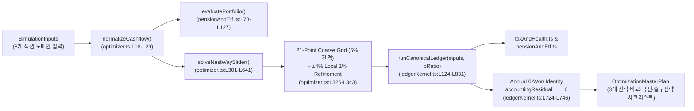

# NestWay Slider — 금융엔진(Canonical 5-Basket Ledger) 상세 로직 분석 보고서

> **문서 버전**: v1.2.0 (2026-10-04 기준)  
> **대상 애플리케이션**: **NestWay Slider** (`:8089`, `nestway_slider`)  
> **분석 대상 디렉토리**: `src/engine/**` (총 8개 TypeScript 모듈, 2,285 LOC)  
> **핵심 설계 철학**: **Single Canonical 5-Basket Ledger Engine (`runCanonicalLedger`)** — 개인 100%(`personalRatio = 100`), 법인 100%(`personalRatio = 0`), 하이브리드(`0 < personalRatio < 100`)를 별도 분기 코드 없이 **단일 상태머신**과 **연간 0원 보존 항등식(`accountingResidual === 0`)**으로 통합 연산.

---

## 1. 엔진 아키텍처 개요 및 모듈 토폴로지

NestWay Slider의 금융엔진(`src/engine/`)은 외부 런타임 의존성이 전혀 없는 **100% 순수 함수형(Deterministic Pure-TypeScript) 커널**로 설계되어 있습니다. 모든 전략 비교는 `runCanonicalLedger(inputs, personalRatio)` 단일 함수에 `personalRatio ∈ [0, 100]` 파라미터만 다르게 주입하여 실행함으로써 시나리오 간 비대칭 버그(Cross-Engine Drift)를 원천 차단합니다.

### 1.1 모듈별 역할 및 코드 라인 수 (총 2,285 LOC)

| 모듈 파일 | 라인 수 | 핵심 엔트리 함수 / 상수 | 아키텍처 역할 및 책임 |
| :--- | :---: | :--- | :--- |
| [`src/engine/index.ts`](./src/engine/index.ts#L1-L9) | 9 | Barrel Export | 7개 하위 엔진 모듈의 공개 심볼 일괄 재수출 |
| [`src/engine/constants.ts`](./src/engine/constants.ts#L1-L96) | 96 | `INCOME_TAX_BRACKETS_2026`, `HEALTH_INSURANCE_RATE_2026` 등 | 2024년 건보료 개편안 및 2026년 대한민국 세법/건보료/국민연금 상수 테이블 |
| [`src/engine/types.ts`](./src/engine/types.ts#L1-L378) | 378 | `SimulationInputs`, `YearlyLedgerRow`, `OptimizationMasterPlan` | 8대 입력 도메인 스키마, 51개년 연간 원장 행, 최적화 마스터플랜 출력 계약 정의 |
| [`src/engine/presets.ts`](./src/engine/presets.ts#L1-L356) | 356 | `DEFAULT_SIMULATION_INPUTS`, `PRESET_SCENARIOS` | 기본값(12.9억 표준), 19억 비교 시나리오, 4대 대표 가구 프리셋 정의 |
| [`src/engine/portfolioPresets.ts`](./src/engine/portfolioPresets.ts#L1-L171) | 171 | `PORTFOLIO_PRESETS`, `scalePresetToTotal`, `rebalanceHoldingsToTotal` | 4대 ETF 모델 포트폴리오 및 총액 보존(Sum-Preserving) 정수 리밸런싱 유틸리티 |
| [`src/engine/taxAndHealth.ts`](./src/engine/taxAndHealth.ts#L1-L431) | 431 | `calculatePersonalPensionTax`, `solveExecutivePayroll`, `calculateRegionalHealthInsurance` | 종합소득세, 사적연금 Min-Tax, 법정 퇴직소득세, 해외양도세, 법인세, 지역건보료, 법인 임원급여 역산 솔버 |
| [`src/engine/pensionAndEtf.ts`](./src/engine/pensionAndEtf.ts#L1-L196) | 196 | `calculatePublicPensionAnnual`, `evaluatePortfolio`, `evaluateRealEstateForYear` | 국민연금(조기/정상/연기+임의계속가입), ETF 가중 수익률, 부동산 4대 전략(유지/다운사이징/매각임대/주택연금) |
| [`src/engine/ledgerKernel.ts`](./src/engine/ledgerKernel.ts#L1-L832) | 832 | `runCanonicalLedger`, `withdrawWithBasis`, `resolveCorporateExitNetWorth` | **단일 5-바스켓 원장 상태머신**, 재직기 적립, 은퇴 D-Day 재배치, 8단계 인출 워터폴, 0원 보존 항등식 검증 |
| [`src/engine/optimizer.ts`](./src/engine/optimizer.ts#L1-L645) | 645 | `solveNestWaySlider` (`solveOptimizationMasterPlan` 별칭), `solveSustainableMonthlyLiving` | 0%~100% 하이브리드 배분 탐색, 지속가능 월 생활비 이분탐색(12회), 법인 손익분기점 및 4대 출구전략 비교 |

### 1.2 데이터 및 연산 파이프라인 흐름도

---

## 2. 도메인 입력 스키마(`SimulationInputs`) 및 4대 대표 프리셋

### 2.1 `SimulationInputs` 8대 하위 도메인 스키마 ([`types.ts:L176-L185`](./src/engine/types.ts#L176-L185))

1. **`asset` (`AssetCompositionInput`, [`types.ts:L29-L41`](./src/engine/types.ts#L29-L41))**:
   - `totalInvestment`: 금융 투자원금 총액 (기본 `1,000,000,000`원 = 10억)
   - `emergencyCash`: 비상 예비자금 (기본 `50,000,000`원, 개인 일반계좌 원금에 합산)
   - `Growth : Dividend` 매크로 비중(`growthEtfRatio = 70`, `dividendEtfRatio = 30`) 및 기대수익률(`growthRate = 6.0%`, `dividendYield = 4.0%`)
   - `overseasRatio`: 개인 일반계좌 내 해외주식/해외상장 ETF 비중 (기본 `70%`, 양도세 22% 과세 대상 비율 결정)
   - `useDetailedHoldings`: `false`(매크로 70:30 비중 모드) vs `true`(`holdings: EtfHoldingItem[]` 개별 종목 가중 모드)
2. **`accounts` (`TaxShelteredAccountInput`, [`types.ts:L43-L57`](./src/engine/types.ts#L43-L57))**:
   - `isaBalance`(`40,000,000`원), `pensionSavingsBalance`(`60,000,000`원), `irpBalance`(`0`원), `expectedSeverance`(`200,000,000`원), `serviceYears`(`20`년, 1~50년 클램핑), `severanceTransferToIrp`(`true`)
   - 절세 채우기 옵션: `autoFillIsaOnRetire`, `enableDoubleIsa`, `autoFillPensionCapOnRetire`, `pensionStartAge`(`55`세), `pensionWithdrawalYears`(`20`년)
3. **`pension` (`PublicPensionInput`, [`types.ts:L59-L80`](./src/engine/types.ts#L59-L80))**:
   - 본인(`selfCurrentAge = 50`, `selfRetireAge = 55`, `selfExpectedMonthly = 1,800,000`, `selfStartAge = 65`, `selfOption = 'normal'`) 및 배우자(`hasSpouse = true`, `spouseCurrentAge = 48`, `spouseExpectedMonthly = 800,000`) 국민연금 수령 조건, 임의계속가입(`additionalContributionMonths`)
4. **`realEstate` (`RealEstateInput`, [`types.ts:L87-L108`](./src/engine/types.ts#L87-L108))**:
   - 자가 보유(`hasResidentialProperty = true`), 시가(`marketValue = 1,200,000,000`원), 공시가격 현실화율(`officialPriceRatio = 69%`), 4대 전략(`'keep' | 'downsize' | 'sell_rent' | 'housing_pension'`)
5. **`cashflow` (`CashflowAndLifestyleInput`, [`types.ts:L110-L129`](./src/engine/types.ts#L110-L129))**:
   - 재직 중 월 소득(`preRetireMonthlyNetIncome = 9,500,000`) 및 월 고정지출(`preRetireMonthlyFixedExpense = 5,500,000`)
   - 은퇴 후 3단계 연령별 목표 월 생활비: 활동기(`activeMonthlyLiving = 6,500,000`), 완숙기(`midStartAge = 75`, `midMonthlyLiving = 5,200,000`), 후기(`lateStartAge = 85`, `lateMonthlyLiving = 4,500,000`), 물가상승률(`inflationRate = 2.5%`), 뷰 모드(`viewMode = 'real' | 'nominal'`)
6. **`corporate` (`CorporateParametersInput`, [`types.ts:L134-L152`](./src/engine/types.ts#L134-L152))**:
   - 법인 설립 초기비용(`initialSetupCost = 2,000,000`), 월 고정유지비(`monthlyFixedMaintenance = 350,000`, 세무기장료+공유오피스), 자본금 비율(`paidInCapitalRatio = 10%`, 나머지 90%는 주주대여금 `shareholderLoan`), 본인/배우자 월 목표 실수령 급여(`selfMonthlyNetSalaryTarget = 2,500,000`, `spouseMonthlyNetSalaryTarget = 2,000,000`), 과세 모드(`taxationMode = 'realized' | 'mark_to_market' | 'transparent'`)
7. **`transition` (`TransitionEventsInput`, [`types.ts:L154-L165`](./src/engine/types.ts#L154-L165))**:
   - 은퇴 전 일시 목돈 유입(`lumpSumInflowAge`, `lumpSumInflowAmount`), 자녀 결혼/독립 자금 유출(`childSupportAge = 62`, `childSupportAmount = 150,000,000`)
8. **`hybrid` (`HybridAllocationInput`, [`types.ts:L167-L174`](./src/engine/types.ts#L167-L174))**:
   - `personalRatio = 45`, `corporateRatio = 55`, `useAutoOptimalRatio = true`

### 2.2 포트폴리오 기대수익률 산식 (`evaluatePortfolio`, [`pensionAndEtf.ts:L78-L127`](./src/engine/pensionAndEtf.ts#L78-L127))

- **매크로 비중 모드 (`useDetailedHoldings === false`, [`pensionAndEtf.ts:L109-L126`](./src/engine/pensionAndEtf.ts#L109-L126))**:
  $$\text{gWeight} = \frac{\text{growthEtfRatio}}{\text{growthEtfRatio} + \text{dividendEtfRatio}}, \quad \text{dWeight} = 1 - \text{gWeight}$$
  $$\text{weightedCapRate} = \frac{\text{growthRate}}{100} \cdot \text{gWeight}, \quad \text{weightedDivRate} = \frac{\text{dividendYield}}{100} \cdot \text{dWeight}$$
  기본값(`70 : 30`, `growthRate = 6.0%`, `dividendYield = 4.0%`) 대입 시:
  $$\text{weightedCapRate} = 0.06 \times 0.70 = 4.20\%, \quad \text{weightedDivRate} = 0.04 \times 0.30 = 1.20\%, \quad \text{weightedTotalRate} = 5.40\%$$
- **상세 ETF 종목 모드 (`useDetailedHoldings === true`, [`pensionAndEtf.ts:L80-L107`](./src/engine/pensionAndEtf.ts#L80-L107))**:
  각 종목 $i$의 실부담 총보수(`actualExpenseRatio`)를 주가수익률(`expectedCapGrowth`)에서 우선 차감하고 남는 보수는 배당수익률(`expectedDivYield`)에서 차감하여 순수익률을 가중평균합니다:
  $$\text{netCap}_i = \max\left(0, \frac{\text{expectedCapGrowth}_i - \text{actualExpenseRatio}_i}{100}\right)$$
  $$\text{netDiv}_i = \max\left(0, \frac{\text{expectedDivYield}_i - \max(0, \text{actualExpenseRatio}_i - \text{expectedCapGrowth}_i)}{100}\right)$$

### 2.3 4대 대표 가구 프리셋 ([`presets.ts:L245-L355`](./src/engine/presets.ts#L245-L355)) 및 ETF 리밸런싱 불변식 ([`portfolioPresets.ts:L83-L171`](./src/engine/portfolioPresets.ts#L83-L171))

- **4대 대표 시나리오 프리셋**:
  1. `standard-12.9b` (**표준 은퇴 준비 가구 12.9억**): 금융 10억 + 비상금 0.5억 + ISA 0.4억 + 연금저축 0.6억 + 예상퇴직금 2억, 50세 재직 ➔ 55세 은퇴, 월 목표 생활비 650만 원.
  2. `high-net-worth-25b` (**고액 금융자산가 25억**): 금융 22억 + 예비자금 1억 + 퇴직금 3억, 55세 즉시 은퇴(`selfCurrentAge = 55, selfRetireAge = 55`), 월 목표 생활비 1,000만 원, 최적 하이브리드(개인 35% : 법인 65%).
  3. `real-estate-heavy` (**부동산 편중 가구 30억 시가 아파트 + 금융 6억**): 금융 5억 + 30억 고가주택 보유 ➔ 60세 은퇴 시 15억 주택으로 다운사이징(`downsizeNewPropertyValue = 15억`, 차익 유동화).
  4. `early-fire-45` (**45세 조기은퇴 파이어족 18억**): 45세 즉시 은퇴, 연금개시 55세까지 10년 브릿지 구간 돌파, 국민연금 조기수령(`early`, 60세 개시).
- **ETF 포트폴리오 정수 리밸런싱 불변식 (`scalePresetToTotal`, [`portfolioPresets.ts:L83-L99`](./src/engine/portfolioPresets.ts#L83-L99))**:
  프리셋 적용(`applyPresetToHoldings`), 총액 변경(`rebalanceHoldingsToTotal`), 종목 추가(`addHoldingKeepingTotal`) 시 앞선 $N-1$개 종목은 `Math.floor(totalInvestment * weight)`로 배정하고, 마지막 종목에 잔여 원화(`totalInvestment - runningSum`)를 배정하여 **항상 $\sum \text{amount} \equiv \text{totalInvestment}$ (1원 오차 없음)** 불변식을 보장합니다.

---

## 3. 시뮬레이션 타임라인 및 재직기(Pre-Retirement) 적립·물가연동 로직

### 3.1 타임라인 인덱스(`idx`) 및 물가연동 배수(`inflationMultiplier`, [`ledgerKernel.ts:L136-L237`](./src/engine/ledgerKernel.ts#L136-L237))

- 시뮬레이션은 본인 현재 연령(`startAge = selfCurrentAge`, 기본 50세)부터 100세(`LIFE_EXPECTANCY_AGE = 100`)까지 총 $N = 100 - \text{startAge} + 1$개년(기본 **51개년**, `idx = 0 ... 50`) 동안 1년 단위로 실행됩니다.
- 연차 `idx`에서의 물가연동 배수는 `idx = 0`(현재 연령)을 기준(`1.0`)으로 복리 계산됩니다 ([`ledgerKernel.ts:L229`](./src/engine/ledgerKernel.ts#L229)):
  $$\text{inflationMultiplier}(\text{idx}) = \left(1 + \frac{\text{inflationRate}}{100}\right)^{\text{idx}}$$

### 3.2 Day-0 초기 계좌 잔고 보존 및 ISA 누적 납입한도 추적 ([`ledgerKernel.ts:L186-L308`](./src/engine/ledgerKernel.ts#L186-L308))

- **재직 중(`ageSelf < retireAgeSelf`) 초기 배치 ([`ledgerKernel.ts:L205-L216`](./src/engine/ledgerKernel.ts#L205-L216))**:
  - 재직 중에는 법인을 설립하지 않고 휴면 상태로 둡니다 (**Invariant `5-A`: 재직 중 법인 계좌 잔고 0원 및 유지비/법인세 0원**, [`ledgerKernel.ts:L213-L216`](./src/engine/ledgerKernel.ts#L213-L216)).
  - 사용자가 이미 보유한 Day-0 `irpBalance`, `isaBalance`, `pensionSavingsBalance`는 재직 첫해부터 그대로 각 절세계좌에 보존되며, 나머지 금융자산(`totalInvestment + emergencyCash - isaBalance - pensionSavingsBalance`)은 개인 일반과세 계좌(`personalTaxable`)에서 운용됩니다.
- **재직 중 연간 흑자 저축액 적립 ([`ledgerKernel.ts:L240-L307`](./src/engine/ledgerKernel.ts#L240-L307))**:
  - 연간 순현금흐름 흑자 $\Delta S = (\text{preRetireMonthlyNetIncome} - \text{preRetireMonthlyFixedExpense}) \times 12 \times \text{inflationMultiplier}$가 발생하면:
    1. **ISA 우선 납입 ([`ledgerKernel.ts:L247-L276`](./src/engine/ledgerKernel.ts#L247-L276))**: 연간 한도(`2,000만 원/인`, 부부 합산 `4,000만 원`)와 **생애 누적 납입원금 한도(`ISA_TOTAL_CONTRIBUTION_CAP = 100,000,000`원/인, `selfIsaPrincipal` 및 `spouseIsaPrincipal` 별도 추적)**의 잔여 한도 내에서 최우선 적립합니다.
    2. **연금저축 납입 ([`ledgerKernel.ts:L278-L290`](./src/engine/ledgerKernel.ts#L278-L290))**: 남은 저축액에서 연간 세액공제 납입한도(`1,800만 원/인`, 부부 `3,600만 원`)까지 연금저축(`personalPension`)에 적립합니다.
    3. **초과 저축액의 `pRatio : cRatio` 버킷 분리 ([`ledgerKernel.ts:L292-L305`](./src/engine/ledgerKernel.ts#L292-L305))**: 절세계좌 한도를 초과한 잉여 저축액(`excessSaving`)은 개인 몫(`Math.round(excessSaving * pRatio)`)은 `personalTaxable`에, 법인 예정 몫(`excessSaving - personalShare`)은 `preRetireCorpBucket`에 적립하여 은퇴 D-Day에 법인으로 일괄 출자합니다.

---

## 4. 은퇴 D-Day 5대 계좌 재배치(Rebalancing) 및 초기 자본 구성 공식

은퇴 도달 연차(`ageSelf === retireAgeSelf`, 또는 즉시 은퇴 시 `idx === 0`)에 [`ledgerKernel.ts:L311-L368`](./src/engine/ledgerKernel.ts#L311-L368)에서 5대 계좌 재배치가 실행됩니다.

### 4.1 퇴직금 수령 및 법정 퇴직소득세 차감 (`Invariant T5`, [`ledgerKernel.ts:L315-L327`](./src/engine/ledgerKernel.ts#L315-L327))

- **IRP 과세이연 이전 (`severanceTransferToIrp === true`)**:
  - 예상 퇴직금(`expectedSeverance`) 전액이 세금 차감 없이 `irp` 계좌로 유입되며, 퇴직소득 원금 추적 변수 `irpSeverancePrincipal += expectedSeverance`에 기록됩니다. 이후 연금 인출 시 원금 비중만큼은 **근속연수 기반 퇴직소득세의 70%(1~10년차) 또는 60%(11년차+)**로 감면 과세됩니다.
- **일시금 현금 수령 (`severanceTransferToIrp === false`)**:
  - [`calculateRetirementIncomeTax(rawSeverance, serviceYears, 0)`](./src/engine/taxAndHealth.ts#L107-L170)을 호출하여 근속연수 공제 및 환산급여 공제를 거친 법정 퇴직소득세(`lumpSumRetireTax`)를 즉시 원천징수(`severanceLumpSumTaxInYear`)하고, 세후 순수령액(`netSeveranceLumpSum = rawSeverance - lumpSumRetireTax`)만 자유유동자금 풀(`liquidBalance`)에 합산합니다.

### 4.2 D-Day 5대 바스켓 초기 배분 공식 ([`ledgerKernel.ts:L329-L368`](./src/engine/ledgerKernel.ts#L329-L368))

자유유동자금 풀 $L = \text{personalTaxable.balance} + \text{preRetireCorpBucket.balance} + \text{netSeveranceLumpSum}$ 에서:
1. **ISA 1억 한도 채우기 (`autoFillIsaOnRetire`)**: 본인/배우자 누적 ISA 납입원금(`selfIsaPrincipal`, `spouseIsaPrincipal`)이 각 1억 원에 미달하는 잔여 한도만큼 $L$에서 `isa`로 이체.
2. **연금저축 한도 채우기 (`autoFillPensionCapOnRetire`)**: 1인당 연간 납입한도(`1,800만 원`)만큼 $L$에서 `personalPension`으로 추가 이체.
3. **개인 일반계좌 vs 법인 계좌 분할 (`pRatio : cRatio`, [`ledgerKernel.ts:L351-L368`](./src/engine/ledgerKernel.ts#L351-L368))**:
   남은 자유유동자금 $L_{\text{rem}}$에 대해:
   $$\text{targetCorpGross} = \text{round}(L_{\text{rem}} \times cRatio), \quad \text{targetPersonal} = L_{\text{rem}} - \text{targetCorpGross}$$
   법인 설립 시 초기 설립비(`setupFee = corporate.initialSetupCost`, 기본 200만 원)가 차감된 순출자금 $\text{netCorpFunding} = \max(0, \text{targetCorpGross} - \text{setupFee})$이 `corporate` 바스켓의 시작 잔고이자 취득원가가 되며, 자본금과 주주대여금은 다음과 같이 분리 기록됩니다:
   $$\text{corpPaidInCapital} = \text{round}\left(\text{netCorpFunding} \times \frac{\text{paidInCapitalRatio}}{100}\right), \quad \text{corpShareholderLoan} = \text{netCorpFunding} - \text{corpPaidInCapital}$$

---

## 5. 연간 운용 수익 및 세금·건보료 정산 메커니즘

### 5.1 5대 바스켓 연간 운용수익 산출 ([`ledgerKernel.ts:L370-L407`](./src/engine/ledgerKernel.ts#L370-L407))

매 연차 시작 잔고 $B_k$에 대해 자본차익 $G_k = \text{round}(B_k \cdot r_{\text{cap}})$과 배당수익 $D_k = \text{round}(B_k \cdot r_{\text{div}})$이 가산됩니다.
- **개인 일반계좌 배당 소득세 원천징수 ([`ledgerKernel.ts:L378-L392`](./src/engine/ledgerKernel.ts#L378-L392))**:
  - `personalTaxableDivReturn`이 금융소득 종합과세 기준(`2,000만 원`, `FINANCIAL_INCOME_COMPREHENSIVE_THRESHOLD`) 이하이면 `15.4%` 분리과세로 종결되며, 세후 배당금(`personalTaxableNetDiv`)은 계좌에 재투자되지 않고 **1순위 생활비 현금흐름으로 즉시 사용**됩니다.
  - `2,000만 원` 초과분(`comprehensiveFinancialIncomeExcess`)은 종합소득 과세표준에 합산되어 누진세율로 정산됩니다.
- **절세계좌(ISA·연금저축·IRP) 과세이연 복리 재투자 ([`ledgerKernel.ts:L394-L404`](./src/engine/ledgerKernel.ts#L394-L404))**:
  - 운용 기간 중에는 배당세나 양도세를 차감하지 않고 $G_k + D_k$ 전액이 계좌 잔고에 재투자됩니다.

### 5.2 법인 과세 모드(`taxationMode`) 및 법인세 정산 (`Invariant 6-A`, [`ledgerKernel.ts:L423-L639`](./src/engine/ledgerKernel.ts#L423-L639))

법인에서 임원 급여 총액(`corpGrossPayrollCost`, 4대보험 사업주 부담분 포함)과 연간 고정 유지비(`corpMaintenanceCost`)를 지출한 뒤, [`ledgerKernel.ts:L621-L638`](./src/engine/ledgerKernel.ts#L621-L638)에서 과세 모드에 따라 법인 과세표준(`corpTaxableIncome`)을 산출합니다:
- **`'realized'` (실현이익 과세 — 기본값, `Invariant 6-A`)**:
  보유 중 미실현 주식 평가차익(`corpCapReturn`)은 과세하지 않고, **실현된 배당수익(`corpDivReturn`) + 주식 매도 실현차익(`realizedCorpCapGainFromSale`)**만 익금에 산입합니다:
  $$\text{corpTaxableIncome} = \max\left(0, \text{corpDivReturn} + \text{realizedCorpCapGainFromSale} - \text{corpMaintenanceCost} - \text{corpGrossPayrollCost}\right)$$
- **`'mark_to_market'` / `'transparent'`**:
  미실현 자본차익을 포함한 총 운용수익(`corpTotalReturn`)에서 비용을 차감하여 과세표준을 계산하며, [`calculateCorporateTax`](./src/engine/taxAndHealth.ts#L191-L212)에 의해 과표 `2억 원` 이하 `9.9%`, `2억 원` 초과분 `20.9%`(투명법인 모드는 단일 `20.9%`)의 법인세(지방소득세 포함)가 부과됩니다.

### 5.3 법인 임원 급여 역산 솔버 (`solveExecutivePayroll`, [`taxAndHealth.ts:L314-L403`](./src/engine/taxAndHealth.ts#L314-L403))

목표 월 실수령액(`targetMonthlyNet`)을 달성하기 위한 세전 월급(`grossMonthly`)을 **32회 이분탐색(Binary Search)**과 **메모이제이션 캐시(`EXEC_PAYROLL_CACHE`, `1,000원` 단위 라운딩 키)**로 역산합니다:
- **근로소득자 공제 및 4대보험 요율**:
  - 국민연금(60세 미만만 부과): 기준소득월액 상한 `6,170,000원` × `4.5%` (근로자) / `4.5%` (법인)
  - 직장건강보험 + 장기요양보험: 세전 월급 × `3.595%` × `(1 + 13.14%)` (근로자/법인 각각 절반 부담)
  - 근로소득공제 및 기본 인적공제(`150만 원`), 근로소득세액공제 한도 반영 후 세후 실수령액이 `targetMonthlyNet`에 수렴하는 `grossMonthly` 도출.

### 5.4 지역가입자 건강보험료 산출 (`calculateRegionalHealthInsurance`, [`taxAndHealth.ts:L232-L305`](./src/engine/taxAndHealth.ts#L232-L305))

- **피부양자 자격 요건 판정 ([`taxAndHealth.ts:L251-L254`](./src/engine/taxAndHealth.ts#L251-L254))**:
  $$\text{annualAssessableIncome} \le 20,000,000 \quad \land \quad \text{propertyTaxBase} \le 540,000,000$$
- **2024년 재산 기본공제 개편 및 2026년 요율 반영 ([`constants.ts:L48-L62`](./src/engine/constants.ts#L48-L62))**:
  - 재산 과세표준(`공시가격 × 공정시장가액비율 60%`)에서 **`1억 원`(`REFORM_2024_PROPERTY_BASIC_DEDUCTION`)을 기본공제**한 뒤 60등급 재산점수표(`score × 211.5원`)를 적용합니다. (단, 2024년 자동차 건보료 폐지 반영 완료)
  - 소득 건보료: $\max(0, \text{annualAssessableIncome}) \times 7.19\%$ (단, 소득 336만 원 이하는 최저보험료 `19,780원/월`)
  - 장기요양보험료: 산출된 건강보험료의 `13.14%`(`LONG_TERM_CARE_RATE_OF_HI_2026`) 가산.

---

## 6. 8단계 절세 인출 워터폴 (8-Stage Tax-Minimizing Decumulation Waterfall)

은퇴 후(`!isEmployed`) 연간 필요 지출액 `totalRequiredOutflow = targetLivingOutflow + lumpSumOutflow + housingOutflow`를 충당하기 위해 [`ledgerKernel.ts:L445-L645`](./src/engine/ledgerKernel.ts#L445-L645)에서 **한계 세율과 건보료 유발 효과가 가장 낮은 재원부터 순차 인출**합니다.

| 단계 | 인출 재원 (Source Basket) | 코드 위치 (`ledgerKernel.ts`) | 적용 세율 및 과세 규칙 | 지역건보료 소득 산입 여부 |
| :---: | :--- | :---: | :--- | :---: |
| **Stage 1** | **공적연금(국민연금) + 주택연금 + 일반계좌 세후배당금** | [`L446-L450`](./src/engine/ledgerKernel.ts#L446-L450) | 국민연금 연금소득공제 후 누진과세 / 주택연금 비과세 / 배당 15.4% 기원천징수 | 국민연금 전액 산입 (주택연금 0%) |
| **Stage 2/3** | **법인 임원 급여 실수령액 (`stage2CorpNetSalary`)** | [`L452-L473`](./src/engine/ledgerKernel.ts#L452-L473) | 근로소득공제 + 직장가입자 건보 전환 (필요 생활비까지만 급여 지급 캡핑) | **지역건보 완전 면제** (직장건보로 대체) |
| **Stage 4** | **ISA 계좌 인출 (`stage4IsaDraw`)** | [`L475-L497`](./src/engine/ledgerKernel.ts#L475-L497) | 순수익 200만(일반)/400만(서민·부부) 비과세, 초과 수익 **9.9% 분리과세** | **미산입 (0%)** |
| **Stage 5** | **연금저축 + IRP 저율 분리과세 한도 내 인출 (`stage5PensionLowTaxDraw`)** | [`L499-L553`](./src/engine/ledgerKernel.ts#L499-L553) | 55세 이상, 1인당 연 **1,500만 원** 한도 내 연령별 **5.5%(55~69세) / 4.4%(70~79세) / 3.3%(80세+)**; IRP 내 퇴직금 원금은 퇴직소득세의 70%/60% 감면율 적용 | **미산입 (0%)** (사적연금 분리과세) |
| **Stage 6** | **법인 주주대여금 상환 / 감자 무세금 원금 회수 (`stage6CorpCapitalReturn`)** | [`L555-L574`](./src/engine/ledgerKernel.ts#L555-L574) | `corpPaidInCapital + corpShareholderLoan` 한도 내에서 **세금 0% 무세금 인출** (주주 원금 반환) | **미산입 (0%)** |
| **Stage 7** | **개인 일반과세 계좌 매도 (`stage7PersonalTaxableDraw`)** | [`L576-L598`](./src/engine/ledgerKernel.ts#L576-L598) | 매도금액 중 수익 비율(`gainRatio`) × 해외비중(`overseasRatio`)에 대해 1인당 250만 원 공제 후 **22% 양도소득세** | **미산입 (0%)** (양도소득은 건보 제외) |
| **Stage 8-A** | **연금저축/IRP 한도 초과 인출 (`stage8ExcessDraw`)** | [`L600-L618`](./src/engine/ledgerKernel.ts#L600-L618) | `calculatePersonalPensionTax`에 의해 **Min-Tax `min(16.5% 분리과세, 종합소득 합산 누진과세)`** 자동 선택 | 분리과세 선택 시 미산입 |
| **Stage 8-B** | **법인 이익잉여금 초과 배당 인출 (`corpDividendGross`)** | [`L640-L664`](./src/engine/ledgerKernel.ts#L640-L664) | 배당소득세 15.4% 원천징수 + 2,000만 원 초과 시 **임원 근로소득과 합산 누진과세 (`Invariant T4`)** | **차년도 지역건보 부과소득에 이연 반영 (`pendingDividendIncomeForHealth`)** |

---

## 7. 100세 대칭 청산 순자산(`finalDisposableNetWorth`) 및 연간 0원 보존 항등식

### 7.1 연간 0원 회계 보존 항등식 (`accountingResidual === 0`, [`ledgerKernel.ts:L724-L746`](./src/engine/ledgerKernel.ts#L724-L746))

모든 연차 `idx`에서 기초 장부잔고 합계(`startBookTotal`)와 기말 장부잔고 합계(`endBookTotal`)는 다음 항등식을 **1원의 오차도 없이(`accountingResidual === 0`)** 만족합니다:

$$\text{startBookTotal} = \sum_{k \in \{\text{Taxable, ISA, Pension, IRP, Corp}\}} B_{k,\text{start}}$$
$$\text{endBookTotal} = \sum_{k \in \{\text{Taxable, ISA, Pension, IRP, Corp}\}} B_{k,\text{end}} + \text{surplusCashReinvested}$$
$$\text{expectedEndBookTotal} = \text{startBookTotal} + \text{totalGrossReturn} + \text{totalExternalInflow} - \text{livingExpenseOutflow} - \text{totalTaxAndHealthLoad}$$
$$\text{accountingResidual} = \text{endBookTotal} - \text{expectedEndBookTotal} \equiv 0$$

여기서 `totalTaxAndHealthLoad`는 개인 소득세/연금세/양도세 + 은퇴 D-Day 일시금 퇴직소득세 + 법인세 + 건강보험료(직장/지역) + 법인 고정유지비 + 법인 4대보험 사업주 부담분 + 법인 초기 설립비를 모두 합산한 총 비용 유출입니다.

### 7.2 100세 시점 대칭 청산 순자산 (`finalDisposableNetWorth`, [`ledgerKernel.ts:L800-L829`](./src/engine/ledgerKernel.ts#L800-L829))

법인 계좌에 묶여 있는 유보금을 개인 계좌와 공정하게 비교하기 위해, 100세 시점에 모든 계좌의 내재 세금(Latent Exit Tax)을 차감한 **실제 가처분 청산 순자산(`finalDisposableNetWorth`)**을 산출합니다:
1. **법인 청산 가처분 가치 (`resolveCorporateExitNetWorth`, [`ledgerKernel.ts:L100-L119`](./src/engine/ledgerKernel.ts#L100-L119))**:
   - 잔여 무세금 회수 가능 원금(`remainingPaidInCapital + remainingShareholderLoan`)은 세금 `0원`으로 우선 회수합니다.
   - 이를 초과하는 법인 이익잉여금(`retainedEarnings = max(0, corpBalance - taxFreeCap)`)에 대해서는 배당/청산소득세율 `15.4%`(`DIVIDEND_WITHHOLDING_TAX_RATE`)를 차감합니다:
     $$\text{corpExit.disposableNetWorth} = \min(\text{corpBalance}, \text{taxFreeCap}) + \text{retainedEarnings} - \text{round}(\text{retainedEarnings} \times 0.154)$$
2. **개인 일반계좌 내재 해외양도세 차감**: 미실현 차익 × 해외비중(`overseasRatio`)에 대해 250만 원 공제 후 22% 차감.
3. **ISA 내재 분리과세 차감**: 미실현 차익 중 비과세 한도(200만/400만) 초과분에 대해 9.9% 차감.
4. **연금저축/IRP 내재 청산세 차감**: 잔여 잔고에 대해 80세 이상 연금소득세율 `3.3%` 차감.
5. **최종 가처분 순자산 합산 ([`ledgerKernel.ts:L817-L824`](./src/engine/ledgerKernel.ts#L817-L824))**:
   $$\text{finalDisposableNetWorth} = (\text{PersonalTaxable} - T_{\text{overseas}}) + (\text{ISA} - T_{\text{ISA}}) + (\text{Pension} + \text{IRP} - T_{\text{pension}}) + \text{corpExit.disposableNetWorth} + \text{RealEstateEquity}_{100}$$

---

## 8. 하이브리드 최적 배분 솔버(`solveNestWaySlider`) 및 이분탐색·손익분기점·출구전략 알고리즘

### 8.1 2단계 그리드 하이브리드 최적 비중 탐색 ([`optimizer.ts:L326-L343`](./src/engine/optimizer.ts#L326-L343))

`solveNestWaySlider` (하위 호환 별칭: `solveOptimizationMasterPlan`)는 메모이제이션 캐시(`simCache`)를 활용하여 0%~100% 구간에서 최적의 `personalRatio`를 탐색합니다:
1. **1단계 Coarse Grid (21개 포인트)**: `p = 0, 5, 10, ..., 100` (5% 간격)에서 `runCanonicalLedger(inputs, p)`를 실행하여 `compareLedgers` 기준 최우수 포인트 $p^*$를 찾고 `allocationCurve`를 생성합니다.
2. **2단계 Fine Grid (±4% 주변 1% 간격)**: $p \in [\max(0, p^* - 4), \min(100, p^* + 4)]$ 구간을 1% 단위로 정밀 탐색하여 전역 최적해 `bestOptimalRatio`를 확정합니다.
3. **우승 판정 비교 함수 (`compareLedgers`, [`optimizer.ts:L34-L47`](./src/engine/optimizer.ts#L34-L47))**:
   - 1순위: 100세 실질 가처분 순자산(`finalDisposableNetWorth`)이 `100만 원` 이상 큰 쪽 승리
   - 2순위: 자산 고갈 연령(`depletionAgeSelf`, 미고갈 시 101세로 취급)이 더 늦은 쪽 승리
   - 3순위: 미충족 생활비 총액(`totalUnmetSpendingNeed`)이 더 작은 쪽 승리

### 8.2 지속가능 최대 월 생활비 이분탐색 솔버 (`solveSustainableMonthlyLiving`, [`optimizer.ts:L52-L104`](./src/engine/optimizer.ts#L52-L104))

- 완숙기(`midRatio = mid / active`)와 후기(`lateRatio = late / active`)의 생활비 비율을 고정한 채, 100세까지 자산이 고갈되지 않는(`depletionAgeSelf === null && totalUnmetSpendingNeed === 0`) 최대 활동기 월 생활비(`activeMonthlyLiving`)를 탐색합니다.
- 탐색 구간 `[1,000,000원, 35,000,000원]`에서 **12회 이분탐색(Bisection)** 후 `10,000원` 단위로 내림(`Math.floor(low / 10_000) * 10_000`)하여 **1만 원 정밀도**를 보장합니다.

### 8.3 법인 전환 손익분기 금융자산 규모 (`evaluateCorporateBreakEven`, [`optimizer.ts:L109-L165`](./src/engine/optimizer.ts#L109-L165))

- 총 금융자산 규모를 `3억 원`부터 `30억 원`까지 `1억 원` 단위로 스캔하여, 최적 하이브리드(또는 법인)가 개인 100% 대비 100세 가처분 순자산 우위(`advantage > 1,000,000원`)를 확보하는 최초의 금융자산 규모(`minimumAssetForCorpAdvantage`)를 도출합니다.

### 8.4 법인 4대 출구전략 비교 (`evaluateCorporateExitStrategies`, [`optimizer.ts:L170-L270`](./src/engine/optimizer.ts#L170-L270))

80세 시점의 법인 장부잔고(`corpBalanceAt80`)와 누적 무세금 회수 잔여한도(`remainingTaxFreeCap`), 법인 이익잉여금(`retainedEarnings`)을 기준으로 4가지 출구 시나리오의 실효 세부담률을 비교합니다:
1. **`gradual_salary_loan` (주주대여금 상환 + 저율 급여 분산 회수)**: 무세금 원금 회수 후 잔여 이익잉여금을 10~15년간 저율 급여/배당으로 분산 인출 (유효세율 약 `6.6%`).
2. **`liquidation` (일반 해산 및 청산배당 일시 회수)**: 이익잉여금 중 2,000만 원까지는 15.4% 분리과세, 초과분은 종합소득 누진세율 합산 과세.
3. **`share_gift_family` (자녀 지분 증여 및 가업승계)**: 배우자(6억 공제) 및 성년 자녀 2인(각 5천만 공제, 총 7억 증여재산공제)을 활용한 지분 분산 증여 후 배당.
4. **`keep_holding` (100세까지 법인 존속 후 상속)**: 연간 유지비(`annualMaintenance * 20년`)를 추가 부담하되 청산배당 종합과세를 이연.

---

## 9. 한계점, 엣지 케이스 및 검증 커버리지

### 9.1 `ROADMAP.md` 식별 갭(`GAP-01` ~ `GAP-08`)과 엔진 연계성

현재 엔진(`src/engine/**`)은 회계 보존성(`accountingResidual === 0`)과 3대 전략 대칭 비교에서 100% 무결성을 달성하고 있으나, UI-엔진 간 바인딩 및 세법 고도화 측면에서 다음 3가지 아키텍처 특성이 존재합니다:
1. **`GAP-01` (하단 타임라인 듀얼모드 전환 시 차트/KPI 연동)**: 상단 `ExecutiveSummaryCards`와 `AssetComparisonChart`는 `plan.personal100`, `plan.corporate100`, `plan.optimalHybrid` 3개 고정 시계열을 표시하고, 사용자가 슬라이더로 조작한 `plan.activeLedger`는 하단 `CashflowStackChart` 및 `FullLedgerTableModal`에 연결되어 있습니다.
2. **`GAP-02` (ETF 종목 상세 편집 모드의 엔진 연결)**: `evaluatePortfolio`(`pensionAndEtf.ts:L78-L127`)는 이미 `useDetailedHoldings === true`일 때 종목별 `actualExpenseRatio` 차감 후 순수익률을 완벽히 계산하지만, UI에서 `useDetailedHoldings` 토글이 아직 노출되지 않아 기본 매크로 70:30 모드로 동작합니다.
3. **`GAP-03` (재직 중 조기 라이프 이벤트 방어)**: `ledgerKernel.ts:L431-L438`에서 일시 유입/유출(`lumpSumInflow`, `childSupport`)은 은퇴/재직 무관하게 해당 연령(`ageSelf === childSupportAge`)에 발생하지만, 8단계 인출 워터폴은 `!isEmployed`(`ledgerKernel.ts:L445`) 분기 내부에서만 가동됩니다. 따라서 재직기(`ageSelf < retireAgeSelf`)에 자녀 지원금 유출이 설정될 경우를 대비한 재직기 유동성 차감 또는 입력 연령 클램핑(`>= selfRetireAge`)이 로드맵에 등록되어 있습니다.

### 9.2 6대 자동화 테스트 스위트 검증 커버리지 (`scripts/run_tests.sh`)

| 테스트 스위트 파일 | 검증 항목 및 불변식 커버리지 | 검증 결과 |
| :--- | :--- | :---: |
| [`test/ledgerInvariants.test.ts`](./test/ledgerInvariants.test.ts) | 23개 시나리오 × 51개년 = **1,174개 연차 전체 `accountingResidual === 0`**, `5-A`(재직 중 법인 휴면), `6-A`(실현이익 법인세), `T4`(초과배당 합산과세+차년도 건보료), `T5`(퇴직금 일시금 법정 퇴직소득세) | 🟢 PASS |
| [`test/optimizer.test.ts`](./test/optimizer.test.ts) | `solveNestWaySlider` / `solveOptimizationMasterPlan` 4대 프리셋 솔버 무결성, 하이브리드 우위성(`optimalHybrid >= max(personal100, corporate100)`), 지속가능 생활비 단조성 | 🟢 PASS |
| [`test/taxAndHealth.test.ts`](./test/taxAndHealth.test.ts) | 누진 소득세, 사적연금 Min-Tax, 근속연수별 퇴직소득세, 2024 개편 지역건보 1억 공제, 임원 급여 역산 솔버 정밀도 | 🟢 PASS |
| [`test/pensionAndEtf.test.ts`](./test/pensionAndEtf.test.ts) | 국민연금 조기(0.70)/정상(1.00)/연기(1.36) 및 CPI 물가연동, 매크로 5.40% vs 상세 ETF 보수 차감 수익률, 부동산 4대 전략 | 🟢 PASS |
| [`test/portfolioPresets.test.ts`](./test/portfolioPresets.test.ts) | 4대 ETF 포트폴리오 프리셋 리밸런싱 시 $\sum \text{amount} \equiv \text{totalInvestment}$ 보존 검증 | 🟢 PASS |
| [`test/uiParity.test.ts`](./test/uiParity.test.ts) | 13대 UI/문서 계약 및 **NestWay Slider** 브랜드·솔버 정합성 검증 | 🟢 PASS |

---

## 10. 핵심 수식 요약 치트시트

| 구분 | 수식 명칭 | 수학 공식 (Canonical Formula) | 소스코드 위치 |
| :--- | :--- | :--- | :--- |
| **수익률** | 매크로 포트폴리오 기대수익률 | $r_{\text{total}} = r_{\text{cap}} + r_{\text{div}} = \frac{\text{growthRate}}{100}\cdot w_g + \frac{\text{dividendYield}}{100}\cdot w_d \quad (\text{기본 } 4.20\% + 1.20\% = 5.40\%)$ | [`pensionAndEtf.ts:L113-L119`](./src/engine/pensionAndEtf.ts#L113-L119) |
| **물가** | 연차별 CPI 물가배수 & 실질할인 | $M_{\text{cpi}}(\text{idx}) = \left(1 + \frac{\pi}{100}\right)^{\text{idx}}, \quad V_{\text{real}}(\text{idx}) = \text{round}\left(\frac{V_{\text{nominal}}(\text{idx})}{M_{\text{cpi}}(\text{idx})}\right)$ | [`ledgerKernel.ts:L136-L229`](./src/engine/ledgerKernel.ts#L136-L229) |
| **국민연금** | 조기/정상/연기 수령 계수 | $\text{Factor} = \begin{cases} \max(0.70, 1 - 0.06 \times \Delta y_{\text{early}}) & (\text{early}) \\ 1.00 & (\text{normal}) \\ \min(1.36, 1 + 0.072 \times \Delta y_{\text{defer}}) & (\text{deferred}) \end{cases}$ | [`pensionAndEtf.ts:L55-L64`](./src/engine/pensionAndEtf.ts#L55-L64) |
| **퇴직세** | 환산급여 및 연금수령 감면 | $\text{ConvSalary} = \frac{(\text{Severance} - D_{\text{years}}) \times 12}{\text{serviceYears}}, \quad T_{\text{retire,annuity}} = T_{\text{lump}} \times \begin{cases} 0.70 & (1\sim 10\text{년차}) \\ 0.60 & (11\text{년차+}) \end{cases}$ | [`taxAndHealth.ts:L131-L165`](./src/engine/taxAndHealth.ts#L131-L165) |
| **연금세** | 사적연금 초과인출 Min-Tax | $T_{\text{pension}} = \begin{cases} W \times r_{\text{age}} \;\; (r_{\text{age}} \in \{5.5\%, 4.4\%, 3.3\%\}) & (W \le 1,500\text{만/인}) \\ \min\left(W \times 16.5\%, \; T_{\text{prog}}(B_{\text{other}} + W) - T_{\text{prog}}(B_{\text{other}})\right) & (W > 1,500\text{만/인}) \end{cases}$ | [`taxAndHealth.ts:L65-L96`](./src/engine/taxAndHealth.ts#L65-L96) |
| **양도세** | 해외주식 매도 양도소득세 | $T_{\text{overseas}} = \max\left(0, \; W_{\text{taxable}} \cdot \frac{B - \text{Basis}}{B} \cdot r_{\text{overseas}} - 2,500,000 \times N_{\text{holders}}\right) \times 22\%$ | [`taxAndHealth.ts:L175-L186`](./src/engine/taxAndHealth.ts#L175-L186) |
| **법인세** | 지방세 포함 법인세율 | $T_{\text{corp}}(I) = \begin{cases} I \times 9.9\% & (I \le 2\text{억}) \\ 2\text{억} \times 9.9\% + (I - 2\text{억}) \times 20.9\% & (I > 2\text{억}) \end{cases}$ | [`taxAndHealth.ts:L191-L212`](./src/engine/taxAndHealth.ts#L191-L212) |
| **건보료** | 2024 개편 지역가입자 건보료 | $\text{HI}_{\text{annual}} = \left(\text{Income} \times 7.19\% + \text{Score}(\max(0, \text{PropTaxBase} - 1\text{억})) \times 211.5 \times 12\right) \times (1 + 13.14\%)$ | [`taxAndHealth.ts:L262-L300`](./src/engine/taxAndHealth.ts#L262-L300) |
| **원장보존** | 연간 0원 보존 항등식 | $\text{Residual}_t = B_{\text{end},t} - \left(B_{\text{start},t} + R_{\text{gross},t} + I_{\text{ext},t} - C_{\text{living},t} - T_{\text{total},t}\right) \equiv 0$ | [`ledgerKernel.ts:L724-L746`](./src/engine/ledgerKernel.ts#L724-L746) |
| **청산가치** | 100세 법인 대칭 청산 순자산 | $\text{NW}_{\text{corp,exit}} = \min(B_{\text{corp}}, C_{\text{taxFree}}) + \max(0, B_{\text{corp}} - C_{\text{taxFree}}) \times (1 - 15.4\%)$ | [`ledgerKernel.ts:L100-L119`](./src/engine/ledgerKernel.ts#L100-L119) |
